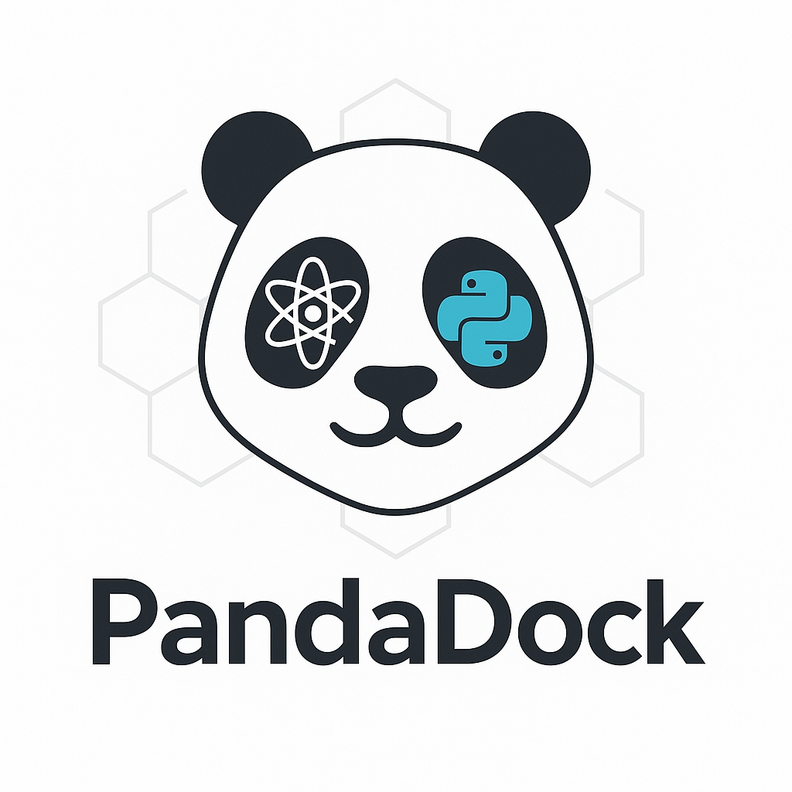

Welcome to PandaDock Documentation
==================================

|

**PandaDock v5.0** is an open-source molecular docking suite combining analytic-gradient flexible-ligand docking (CPU, NVIDIA CUDA, and Apple Silicon MPS) with a complete medicinal-chemistry workflow, **PandaDock Studio** (Apple-designed web GUI with PandaLens 3D/2D visualization), publication A4 vector PDF/HTML reporting, and an **SE(3)-equivariant Graph Neural Network** affinity scoring function trained on 741,706 co-folded complexes (SAIR) under target-disjoint splits.

.. tip::
   **Download the Official Plain-Language User Manual (PDF):**
   :download:`PandaDock v5.0 Official User Manual (24-page A4 PDF with clickable TOC) <_static/PandaDock_v5.0_User_Manual.pdf>`

.. note::
   **What's New in PandaDock v5.0:**

   * **PandaDock Studio GUI** (``pandadock gui`` / ``pandadock-gui``): Guided 4-step workflow, Maestro-style X-ray co-crystal ligand pocket selection & auto-exclusion, separate 3D/2D Ligand Window, **PandaLens** 18-class 3D explicit-H interaction viewer + live interactive 2D interaction map, 300-DPI plot gallery, embedded A4 PDF viewer, and HTML report.
   * **Built-in 11-Point PoseBusters Audit** (``pandadock validate-poses``): Chemistry, geometry, flatness, chirality, MMFF94 strain, and protein clash audit integrated into every run.
   * **pH-Aware Protonation, Tautomer & Stereo Enumeration** (``--enumerate-states --ph 7.4``): Henderson–Hasselbalch microspecies ranking.
   * **Differentiable Geometric / H-Bond / Metal / MCS Restraints** (``--restraint``) & **Displaceable Structural Waters** (``--waters strip|keep|displace``).
   * **Congeneric Series / MCS Core-Tethered Docking & SAR Brochure PDF** (``pandadock series``).
   * **Covalent Warhead Docking** (``pandadock covalent``): 8 medicinal-chemistry warheads + PandaMap covalent 2D/3D diagrams.
   * **Few-Shot Per-Target Weight Calibration** (``pandadock calibrate`` + ``--weights-file``) & **One-Command Dock-to-MD Handoff** (``pandadock to-md`` for OpenMM, GROMACS & PandaInsight).

Quick Start
-----------

Install PandaDock 5.0:

.. code-block:: bash

   conda create -n pandadock python=3.10 -y && conda activate pandadock
   conda install -c conda-forge rdkit -y
   pip install pandadock
   pip install "pandadock[gui]"    # Optional: PandaDock Studio GUI
   pip install "pandadock[gnn]"    # Optional: GPU search (CUDA/MPS) & GNN scoring
   pip install pandamap            # Optional: 2D interaction diagrams

Run your first docking workflow or launch Studio:

.. code-block:: bash

   # 1. Prepare protein & ligand (hydrogens, pH 7.4 protonation, 3D minimization)
   pandadock-prepare -r receptor.pdb -l ligand.sdf --ph 7.4 -o prepared/

   # 2. Define the binding site grid box (from X-ray ligand, cavities, or residues)
   pandadock-gridbox -r prepared/receptor.pdb -m similarity \
                     --reference-ligand xray_ligand.sdf -o box.json

   # 3. Flexible docking with displaceable waters, PoseBusters audit & PDF/HTML reports
   pandadock dock -r prepared/receptor.pdb -l prepared/ligand.sdf -g box.json \
                  --waters displace --workers 4 --seed 42 -o results/

   # 4. Or launch PandaDock Studio (interactive 3D/2D viewer, plots & reports)
   pandadock-gui --port 8765 --workspace .

CLI Footprint (10 Entry Points · 48 Commands)
---------------------------------------------

+-----------------------+---------+---------------------------------------------------------------------+
| Entry Point           | Count   | Purpose                                                             |
+=======================+=========+=====================================================================+
| ``pandadock``         | 18 cmds | ``dock``, ``screen``, ``series``, ``covalent``, ``validate-poses``, |
|                       |         | ``calibrate``, ``to-md``, ``gui``, ``hybrid``, ``list-algorithms``, |
|                       |         | and 8 ``gnn`` subcommands                                           |
+-----------------------+---------+---------------------------------------------------------------------+
| ``pandadock-gui``     | 1 cmd   | Launch PandaDock Studio Apple-designed web GUI                      |
+-----------------------+---------+---------------------------------------------------------------------+
| ``pandadock-prepare`` | 1 cmd   | Receptor & ligand preparation (H, pH 7.4, 3D minimization, states)  |
+-----------------------+---------+---------------------------------------------------------------------+
| ``pandadock-gridbox`` | 1 cmd   | Grid box definition (``similarity``, ``cavities``, ``residues``)    |
+-----------------------+---------+---------------------------------------------------------------------+
| ``pandadock-flex``    | 1 cmd   | 4-phase induced-fit flexible receptor docking                       |
+-----------------------+---------+---------------------------------------------------------------------+
| ``pandadock-metal``   | 5 cmds  | Metalloprotein coordination docking (31 bundled metals)             |
+-----------------------+---------+---------------------------------------------------------------------+
| ``pandadock-tethered``| 4 cmds  | Crystal-ligand extraction, tethered redocking & validation          |
+-----------------------+---------+---------------------------------------------------------------------+
| ``pandadock-report``  | 4 cmds  | Regenerate 300-DPI plots, PandaMap 2D/3D maps & scoring tables      |
+-----------------------+---------+---------------------------------------------------------------------+
| ``pandadock-ml``      | 5 cmds  | Classical ML feature extraction, training & hybrid docking          |
+-----------------------+---------+---------------------------------------------------------------------+
| ``pandadock-gnn``     | 8 cmds  | Standalone SE(3)-equivariant GNN CLI (mirrors ``pandadock gnn *``)  |
+-----------------------+---------+---------------------------------------------------------------------+

Performance Benchmarks
----------------------

.. note::
   Earlier v4.0 documentation reported R = 0.88 on PDBbind and R = 0.82 on ULVSH.
   Those numbers were withdrawn in August 2026 (small-subset label-informed rescaling
   and 96.1% censored ULVSH labels). All figures below are full-dataset evaluations.

**Pose Accuracy (814 Complexes, 14 Target Families):**

+---------------------------------+------------------+----------------+
| Backend                         | Top-1 <= 2 A     | Best-of-N <= 2 |
+=================================+==================+================+
| CPU (auto exhaustiveness)       | 33.7%            | 57.0%          |
+---------------------------------+------------------+----------------+
| CUDA (A10G, 512 chains, 814)    | 30.2%            | 50.5%          |
+---------------------------------+------------------+----------------+
| Paired 131-complex (CPU vs GPU) | 34.4% vs 30.5%   | 56.5% vs 56.5% |
+---------------------------------+------------------+----------------+

**Affinity Prediction (PandaDock-GNN, Native Crystal / Held-out Splits):**

+---------------------------------+------------------+----------------+
| Evaluation                      | N                | Pearson R      |
+=================================+==================+================+
| SAIR held-out test split        | 90,219           | 0.407          |
+---------------------------------+------------------+----------------+
| Independent crystal complexes   | 202              | 0.467          |
+---------------------------------+------------------+----------------+
| PDBbind v2020 refined (indep.)  | 4,640            | 0.531          |
+---------------------------------+------------------+----------------+
| PDBbind-only held-out test      | 624              | 0.690          |
+---------------------------------+------------------+----------------+

Documentation Contents
----------------------

.. toctree::
   :maxdepth: 2
   :caption: Getting Started

   getting_started/installation
   getting_started/quickstart
   getting_started/basic_usage

.. toctree::
   :maxdepth: 2
   :caption: PandaDock v5.0 Suite & Studio GUI

   guide/studio_gui
   guide/medchem_v5
   guide/best_practices
   guide/troubleshooting
   guide/faq

.. toctree::
   :maxdepth: 2
   :caption: Command Line Interface (All 48 Commands)

   cli/pandadock
   cli/pandadock_gui
   cli/pandadock_prepare
   cli/pandadock_gridbox
   cli/pandadock_gnn
   cli/pandadock_flex
   cli/pandadock_metal
   cli/pandadock_tethered
   cli/pandadock_report
   cli/pandadock_ml

.. toctree::
   :maxdepth: 2
   :caption: PandaDock-GNN

   gnn/overview
   gnn/dataset_preparation
   gnn/training
   gnn/prediction
   gnn/hybrid_docking

.. toctree::
   :maxdepth: 2
   :caption: Algorithms & Scoring

   algorithms/overview
   algorithms/cpu_algorithms
   algorithms/gpu_algorithms
   algorithms/specialized_modes
   scoring/overview

.. toctree::
   :maxdepth: 2
   :caption: Tutorials

   tutorials/basic_docking
   tutorials/virtual_screening
   tutorials/flexible_docking
   tutorials/metal_coordination

.. toctree::
   :maxdepth: 2
   :caption: API Reference

   api/docking
   api/gnn
   api/scoring
   api/analysis

.. toctree::
   :maxdepth: 1
   :caption: About

   about/citation
   about/contributing
   about/license
   about/changelog

Indices and tables
==================

* :ref:`genindex`
* :ref:`modindex`
* :ref:`search`

.. note::

   ULVSH affinity labels are censored: inactive compounds take a floor
   value, and 89 of the 95 test-split pEC50 values are exactly 4.0. A
   Pearson correlation over that distribution reflects separation of
   actives from the floor rather than affinity ranking, so ULVSH is
   reported as activity classification (AUC = 0.94). Use PDBbind or
   BindingDB for continuous affinity performance.
